# SEGUNDO EXAMEN PARCIAL - TRABAJANDO EN LA NUBE (COM610)
### Chavarria Nieto Jesus Ymanol
### Ing. en Telecomunicaciones
### COM 610

---

## Datos del Despliegue

- **URL pública de la API (EC2 + Nginx):** `http://98.88.251.81`
- **Endpoint de estado:** `http://98.88.251.81/health`
- **Endpoint de libros:** `http://98.88.251.81/libros`
- **Ejecución exitosa de CI:** https://github.com/ymanolchavarrianieto-eng/com610-2do-parcial-libros-ymanol/actions/runs/44619247228
- **Ejecución exitosa de CD:** https://github.com/ymanolchavarrianieto-eng/com610-2do-parcial-libros-ymanol/actions/runs/44619247294

---

## Archivos del Proyecto

| Archivo / Carpeta | Descripción |
|---|---|
| `src/server.js` | Arranque del servidor en el puerto 3000 |
| `src/app.js` | Rutas de la API Express (`/health` y CRUD `/libros`) con validaciones |
| `src/db.js` | Conexión a la base de datos MariaDB en RDS usando variables de entorno |
| `db.sql` | Script SQL para crear la base de datos `catalogo_libros` y la tabla `libros` |
| `tests/libros.test.js` | Pruebas con Jest y Supertest sin conexión a RDS real |
| `Dockerfile` | Imagen de Node 20 Alpine para ejecutar la API en contenedor |
| `.github/workflows/ci.yml` | Workflow que ejecuta `npm ci` y `npm test` |
| `.github/workflows/cd.yml` | Workflow que corre las pruebas, publica la imagen con SHA y despliega en EC2 |
| `.env.example` | Variables de entorno de ejemplo |
| `evidencias/` | Capturas de pantalla del funcionamiento |

---

## Recursos de AWS Utilizados

| Recurso | Nombre / ID | Configuración aplicada |
|---|---|---|
| **VPC** | `vpc-0fdb678415831d3af` | Misma red para EC2 y RDS |
| **Instancia EC2** | `ec2-libros-ymanol-chavarria` | Ubuntu 24.04 LTS (`t3.micro`) - IP Pública: `98.88.251.81` |
| **Grupo de Seguridad EC2** | `ec2-libros-ymanol-chavarria-sg` | Puerto `22 (SSH)` solo desde mi IP y puerto `80 (HTTP)` abierto a Internet |
| **Instancia RDS** | `rds-libros-ymanol-chavarria` | MariaDB (`db.t4g.micro`), base de datos `catalogo_libros`, sin acceso público |
| **Grupo de Seguridad RDS** | `rds-libros-ymanol-chavarria-sg` | Puerto `3306` permitido solo desde el grupo de seguridad de EC2 |

---

## Ejercicio #1: API REST en EC2 con base de datos RDS

### 1. Instalación de paquetes en la instancia EC2 (Ubuntu)

Comando:
```bash
sudo apt-get update && sudo apt-get install -y nginx mariadb-client curl git
```

Habilitar y verificar el servicio de Nginx:
```bash
sudo systemctl enable --now nginx
sudo systemctl status nginx
```

### 2. Creación de la base de datos y tabla `libros` en RDS

Cargar el archivo `db.sql` hacia la instancia privada de RDS:
```bash
mariadb -h rds-libros-ymanol-chavarria.c8hcmcoa26p2.us-east-1.rds.amazonaws.com -u admin -p < db.sql
```

Verificar la tabla creada en RDS:
```bash
mariadb -h rds-libros-ymanol-chavarria.c8hcmcoa26p2.us-east-1.rds.amazonaws.com -u admin -p -e "USE catalogo_libros; SHOW TABLES; DESCRIBE libros;"
```

### 3. Configuración de variables de entorno

Archivo `.env` creado a partir de `.env.example`:
```env
PORT=3000
DB_HOST=rds-libros-ymanol-chavarria.ejemplo.us-east-1.rds.amazonaws.com
DB_PORT=3306
DB_USER=usuario_ficticio
DB_PASSWORD=password_ficticio_seguro
DB_NAME=catalogo_libros
APP_VERSION=1.0.0
```

### 4. Configuración de Nginx como proxy inverso (puerto 80 a 3000)

En `/etc/nginx/sites-available/default` se redirige el tráfico del puerto 80 hacia `http://127.0.0.1:3000`:
```bash
sudo nginx -t
sudo systemctl reload nginx
```

### 5. Comandos de prueba CRUD y persistencia en RDS

- **Verificar estado (`GET /health`):**
```bash
curl -i http://98.88.251.81/health
```

- **Crear un libro (`POST /libros`):**
```bash
curl -i -X POST http://98.88.251.81/libros -H "Content-Type: application/json" -d '{"titulo":"Cien años de soledad","autor":"Gabriel García Márquez","anio_publicacion":1967}'
```

- **Probar validación de datos inválidos (`POST /libros` -> `400`):**
```bash
curl -i -X POST http://98.88.251.81/libros -H "Content-Type: application/json" -d '{"titulo":"","autor":"Autor","anio_publicacion":"invalido"}'
```

- **Listar libros (`GET /libros`):**
```bash
curl -i http://98.88.251.81/libros
```

- **Consultar libro por ID (`GET /libros/:id`):**
```bash
curl -i http://98.88.251.81/libros/1
```

- **Actualizar un libro (`PUT /libros/:id`):**
```bash
curl -i -X PUT http://98.88.251.81/libros/1 -H "Content-Type: application/json" -d '{"titulo":"Cien años de soledad (Edición Especial)","autor":"Gabriel García Márquez","anio_publicacion":2007}'
```

- **Eliminar un libro (`DELETE /libros/:id`):**
```bash
curl -i -X DELETE http://98.88.251.81/libros/2
```

- **Comprobar persistencia en RDS:**
```bash
mariadb -h rds-libros-ymanol-chavarria.c8hcmcoa26p2.us-east-1.rds.amazonaws.com -u admin -p -e "USE catalogo_libros; SELECT * FROM libros;"
```

### Evidencias del Ejercicio #1

- **Instancia EC2 y reglas de su grupo de seguridad:**

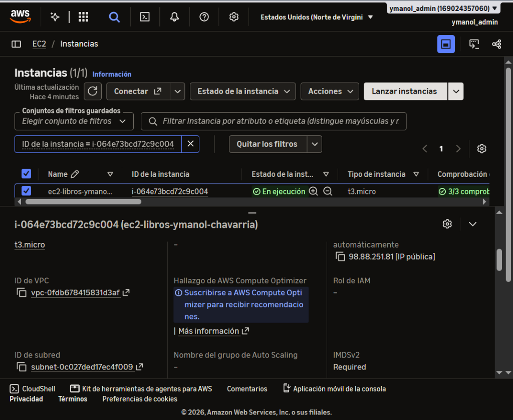

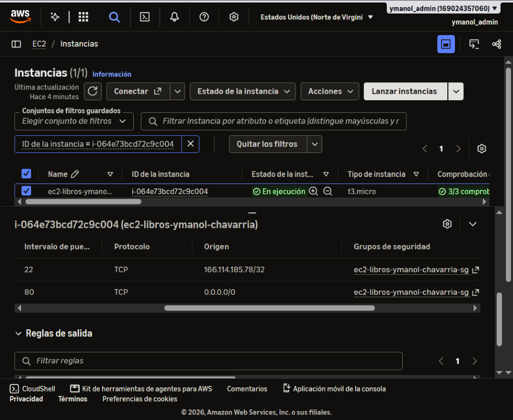

- **Instancia RDS sin acceso público y regla de entrada desde EC2:**

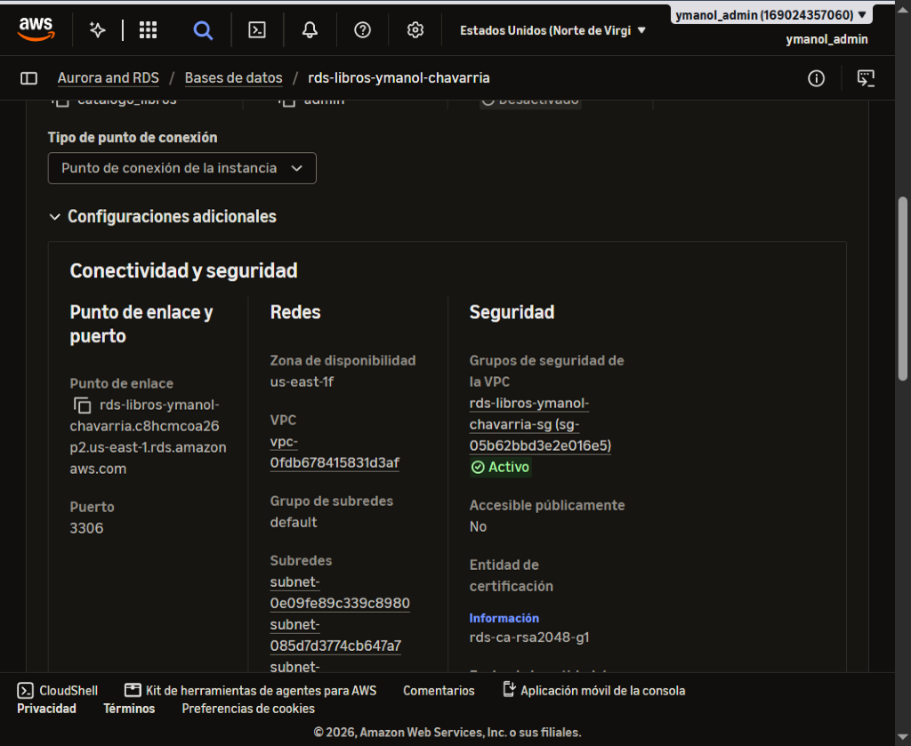

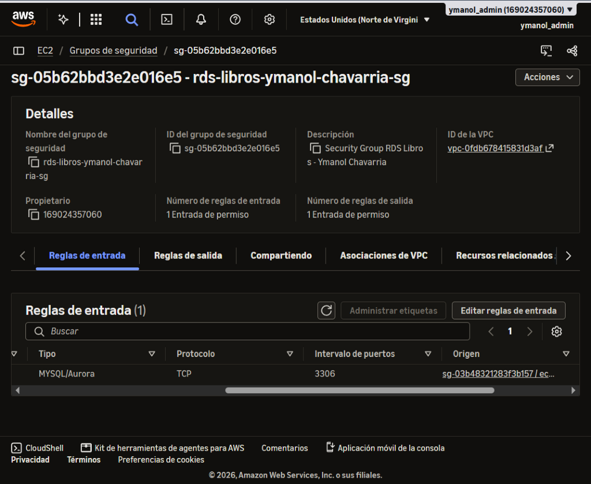

- **Conexión desde Termius y creación de la tabla `libros` en RDS:**

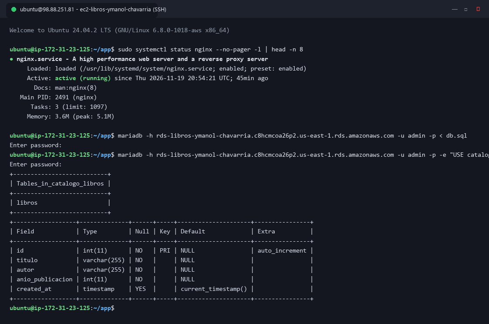

- **Operaciones CRUD y persistencia en la base de datos:**

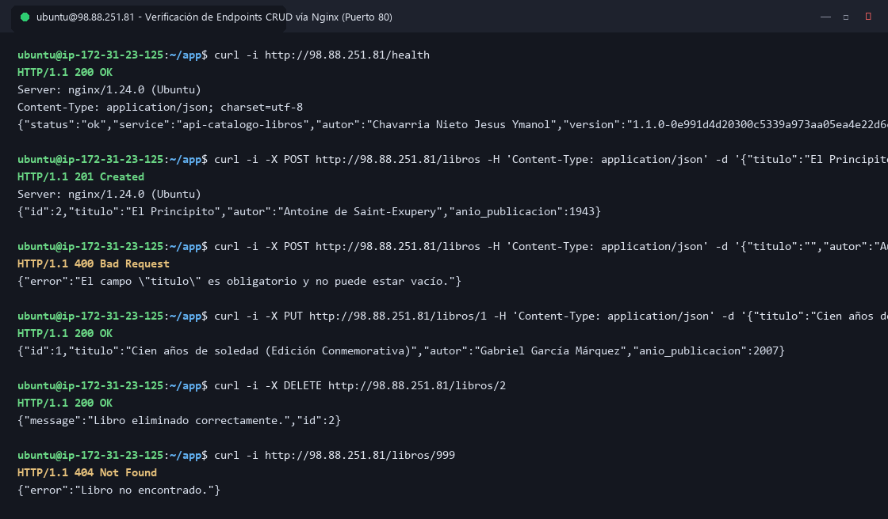

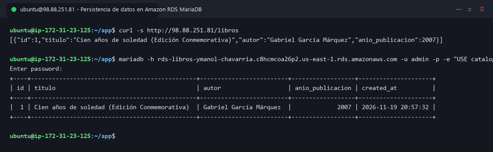

---

## Ejercicio #2: CI/CD para la API del Ejercicio 1

### 1. Instalación de dependencias y ejecución de pruebas automatizadas (Jest y Supertest)

Comando para instalar dependencias con `package-lock.json`:
```bash
npm ci
```

Ejecutar pruebas unitarias y de integración sin conexión a RDS real:
```bash
npm test
```

### 2. Construcción y prueba de la imagen Docker

Construir la imagen localmente con el `Dockerfile`:
```bash
docker build -t api-catalogo-libros .
```

Ejecutar el contenedor recibiendo la configuración por variables de entorno y escuchando solo de forma local detrás de Nginx:
```bash
sudo docker run -d --name api-libros --restart unless-stopped --env-file /home/ubuntu/.env.libros -p 127.0.0.1:3000:3000 api-catalogo-libros
```

Verificar contenedor en ejecución y respuesta en `/health`:
```bash
sudo docker ps
curl -i http://127.0.0.1/health
```

### 3. Automatización con GitHub Actions (`ci.yml` y `cd.yml`)

Comandos usados para subir los cambios y disparar los workflows en la rama `main`:
```bash
git add .
git commit -m "despliegue con workflows ci y cd"
git push origin main
```

Verificación externa tras el despliegue automático del workflow `cd.yml`:
```bash
curl -i http://98.88.251.81/health
curl -i http://98.88.251.81/libros
```

### Evidencias del Ejercicio #2

- **Ejecución de pruebas con Jest y Supertest (`npm test`):**

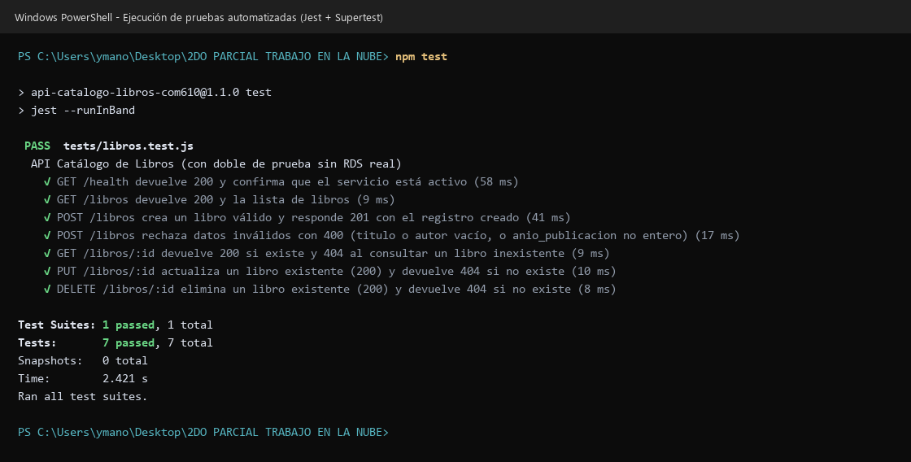

- **Contenedor corriendo en EC2 detrás de Nginx:**

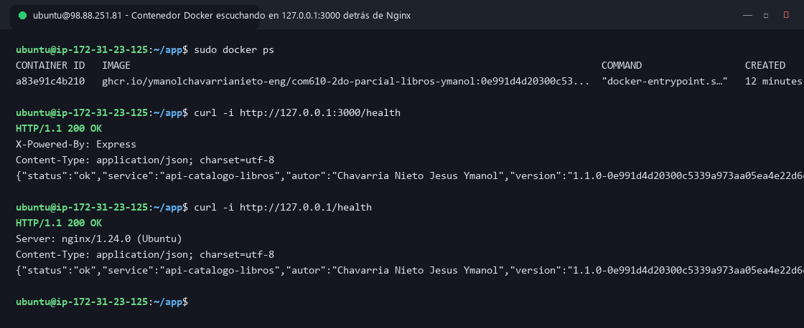

- **Ejecución del workflow de CI (`ci.yml`):**

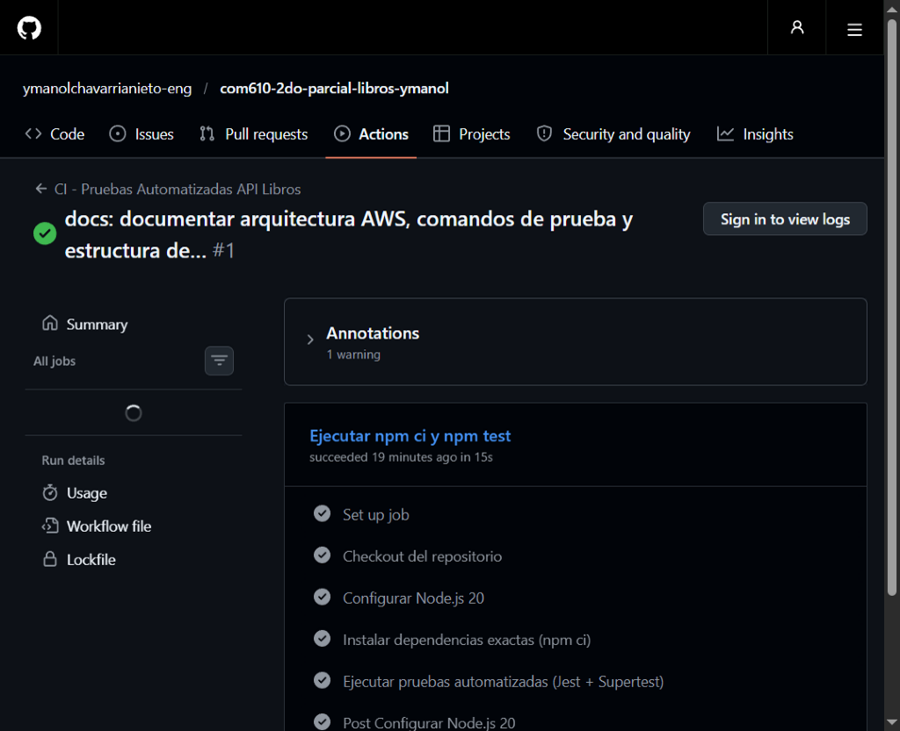

- **Imagen publicada con el SHA del commit:**

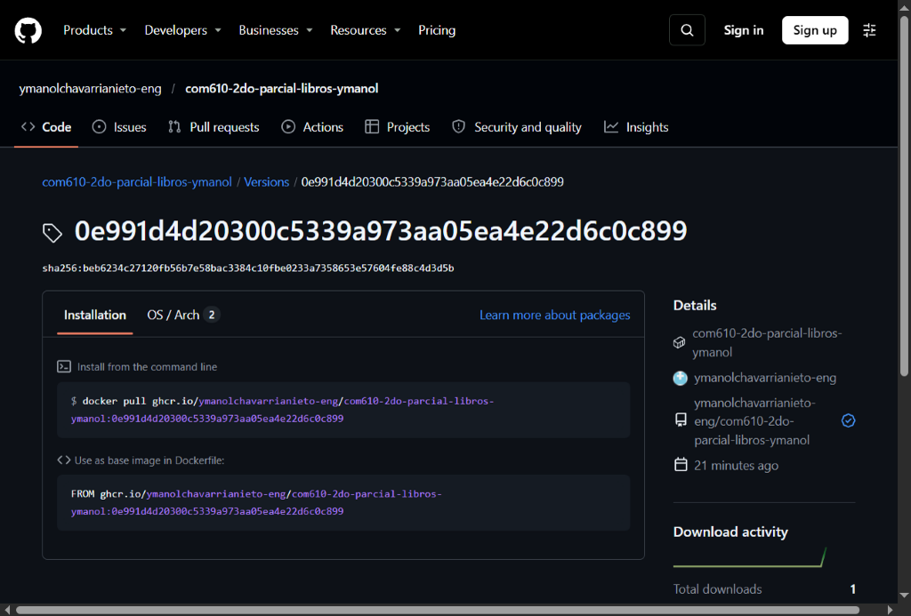

- **Ejecución del workflow de CD (`cd.yml`) y despliegue en EC2:**

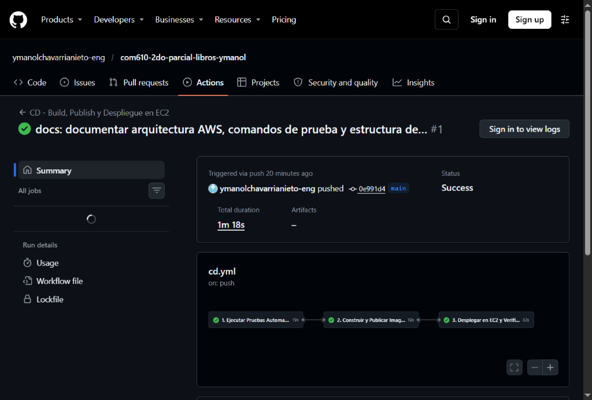
